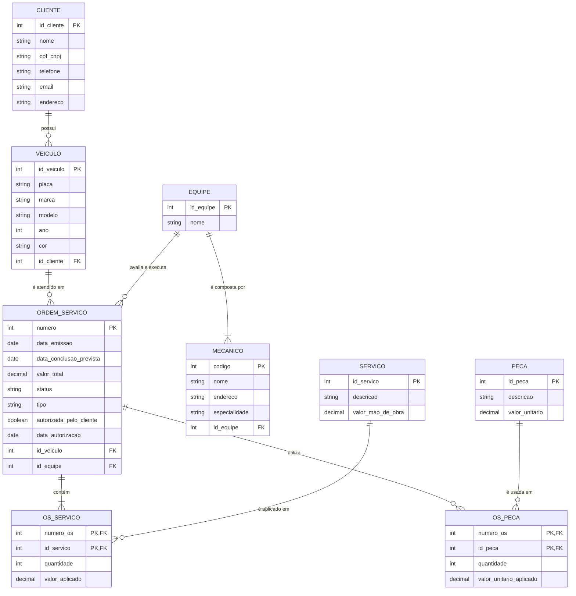

# Esquema Conceitual – Oficina Mecânica (Controle de Ordens de Serviço)

## Descrição do projeto

Modelo conceitual (ER) de um sistema de controle e gerenciamento da execução de Ordens de Serviço (OS) em uma oficina mecânica. Clientes levam veículos para conserto ou revisão periódica; uma equipe de mecânicos identifica os serviços, emite a OS, o cliente autoriza e a mesma equipe executa o trabalho.

## Diagrama (Mermaid)

## Entidades e relacionamentos

| Entidade | Descrição |
|---|---|
| **Cliente** | Pessoa ou empresa que leva veículos à oficina. |
| **Veículo** | Pertence a um cliente; é identificado pela placa. |
| **Equipe** | Grupo de mecânicos designado a um veículo/OS. |
| **Mecânico** | Possui código, nome, endereço e especialidade; pertence a uma equipe. |
| **Ordem de Serviço (OS)** | Número, data de emissão, valor, status e data para conclusão dos trabalhos. |
| **Serviço** | Tabela de referência de mão de obra (descrição e valor). |
| **Peça** | Peças que compõem o valor da OS. |
| **OS_Serviço** | Associativa: serviços executados em cada OS. |
| **OS_Peça** | Associativa: peças usadas em cada OS. |

| Relacionamento | Cardinalidade |
|---|---|
| Cliente – Veículo | 1 : N |
| Veículo – OS | 1 : N |
| Equipe – Mecânico | 1 : N |
| Equipe – OS | 1 : N |
| OS – Serviço | N : M (via OS_Serviço) |
| OS – Peça | N : M (via OS_Peça) |

## Premissas assumidas (pontos não definidos na narrativa)

1. **Equipe como entidade própria:** a narrativa fala em "equipe de mecânicos", então criei a entidade Equipe. Cada mecânico pertence a **uma** equipe, e cada equipe tem **um ou mais** mecânicos.
2. **Uma equipe por OS:** a mesma equipe que identifica os serviços também avalia e executa, por isso a OS referencia uma única equipe.
3. **Valor da OS:** `valor_total` = soma dos serviços (quantidade × valor de mão de obra da tabela de referência) + soma das peças (quantidade × valor unitário).
4. **Histórico de preços:** `valor_aplicado` e `valor_unitario_aplicado` guardam o preço vigente no momento da OS, para que alterações futuras na tabela de referência não mudem OS antigas.
5. **Autorização do cliente:** registrada na própria OS (`autorizada_pelo_cliente` e `data_autorizacao`). Os serviços só são executados após a autorização.
6. **Status da OS:** valores sugeridos: `Aguardando autorização`, `Autorizada`, `Em execução`, `Concluída`, `Cancelada`.
7. **Tipo da OS:** `Conserto` ou `Revisão`, para distinguir os dois motivos de entrada citados na narrativa.
8. **Data de conclusão:** `data_conclusao_prevista` é a data de entrega informada na emissão da OS.
9. **Veículo pertence a um único cliente** no modelo (o proprietário atual).
10. Atributos de Cliente, Veículo e Peça (CPF/CNPJ, placa, marca etc.) foram acrescentados por serem necessários ao contexto, mesmo sem constarem na narrativa.
